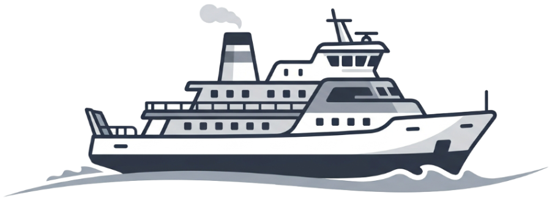

<p align="center">
  
</p>

<h1 align="center">F E R R Y</h1>

<p align="center">
  Your env vars, ferried safely to AWS Parameter Store — no console required.
</p>

A self-hosted web app that puts a simple `.env`-style interface over AWS SSM
Parameter Store. Deploy one container at `ferry.myapp.com`; every secret value
stays in your own AWS account, encrypted with KMS. The app never stores a
secret — its SQLite database holds only users, sessions, audit log and GitHub
mappings.

## Features

- Projects and environments (`myapp` / `development`, `staging`, `production`)
- Add, edit, reveal, delete keys; per-key version history with restore
- Paste or drop a `.env` file and save with a full preview (new/changed/unchanged/removed)
- Download any environment as a `.env` file; copy between environments; diff two environments
- GitHub OAuth sign-in, viewer/editor/admin roles, protected environments
- GitHub Actions integration through OIDC — the app generates IAM roles and a
  one-time setup script; CI reads straight from AWS (works even if Ferry is down)
- $0 in AWS fees for typical use (Parameter Store Standard tier)

## Architecture

One Node 22 process: **Fastify** serves the JSON API and the built **React SPA**
(Vite + Tailwind + shadcn/ui components). SQLite (`better-sqlite3`) on a mounted
volume for metadata. AWS SDK v3 talks to Parameter Store; all calls go through
`ParameterService`.

```
web/     React SPA (Vite)
server/  Fastify API + services
shared/  Zod schemas, .env parser, IAM policy builders — imported by both sides
deploy/  Dockerfile, docker-compose, Caddyfile, IAM policy templates
e2e/     Playwright tests
```

## Development

Requires Node 22 and pnpm.

```bash
cp .env.dev.example .env.dev   # fill in GitHub OAuth + AWS details
pnpm install
pnpm dev                        # vite dev server :5173 → proxies /api to :3000
```

Local AWS calls can point at LocalStack:

```bash
docker run -p 4566:4566 localstack/localstack
AWS_ENDPOINT_URL=http://localhost:4566 pnpm --filter @ferry/server dev
```

(The AWS SDK v3 honors `AWS_ENDPOINT_URL` for local endpoints.)

Tests: `pnpm -r test` (unit + service). LocalStack suite:
`FERRY_TEST_LOCALSTACK=1 pnpm --filter @ferry/server test`.
E2E: see `e2e/playwright.config.ts` header.

## Deploy

See `deploy/`:

- `Dockerfile` — multi-stage; builds the SPA and server, runs as non-root on
  `node:22-slim`, `/data` volume, healthcheck on `/api/healthz`.
- `docker-compose.yml` + `Caddyfile` — app plus automatic HTTPS via Caddy.
- `iam/` — required Parameter Store policy and the optional read-only check
  policy; `fill.sh` stamps in your account/region/prefix.

Quickstart:

```bash
cd deploy
cp .env.example .env   # fill in; SESSION_SECRET=$(openssl rand -hex 32)
./iam/fill.sh 123456789012 us-east-1 ferry   # then attach the policy to your instance role / IAM user
docker compose up -d
```

### GitHub OAuth App

Create a GitHub OAuth App at github.com → Settings → Developer settings:
- Homepage URL: `https://ferry.myapp.com`
- Callback URL: `https://ferry.myapp.com/api/auth/github/callback`

Set `GITHUB_CLIENT_ID`/`GITHUB_CLIENT_SECRET`, then
`ALLOWED_GITHUB_USERS` and/or `ALLOWED_GITHUB_ORG`, and `ADMIN_GITHUB_USERS`.

### Connect GitHub Actions (OIDC)

Settings → GitHub: add an owner, pick **All repos** (shared role per env) or
**Selected repos** (role per project+env, repos assigned individually), copy the
generated script, and run it once with admin AWS credentials. The "Use these
values" tab on each environment produces the workflow snippet. Trust policies
only allow jobs running in the matching GitHub Environment
(`environment: production`), so branch protections and required reviewers on
the GitHub Environment carry over.

> **Warning:** a freed GitHub owner name (renamed or deleted account) can be
> registered by someone else — remove owners you no longer control.

## Security

- Secret values exist only in memory for the duration of a request — never in
  SQLite, logs, temp files or analytics.
- Sessions: `__Host-` HttpOnly cookie, 12h absolute / 2h idle, rotated at login.
- CSRF double-submit header + SameSite=Lax cookies; strict CSP.
- Rate limits on logins, API calls, reveals and the setup probe.
- The server's IAM policy is scoped to `parameter/{PREFIX}/*` and can't write IAM.
- AWS CloudTrail records every Parameter Store call — that is your independent
  audit trail alongside Ferry's own audit log.

See [SECURITY.md](SECURITY.md) to report a vulnerability.
